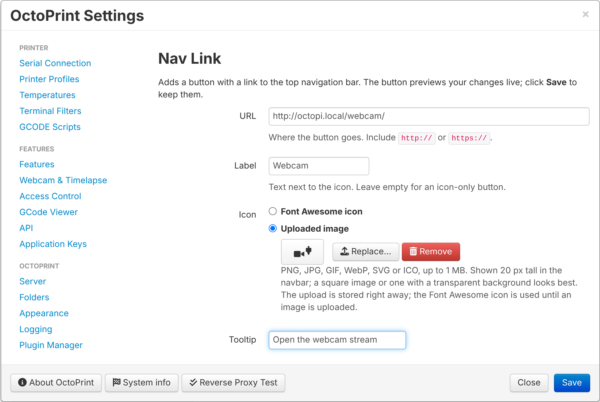

# OctoPrint-NavLink

Adds a button with a link to OctoPrint's top navigation bar: to Home Assistant,
a webcam stream, your NAS, the printer's manual, or anything else you open
next to OctoPrint. URL, label, icon, tooltip and "open in new tab" are set in
**Settings → Nav Link**.

The icon can be any [Font Awesome](https://fontawesome.com/search?ic=free)
icon or an image you upload (PNG, JPG, GIF, WebP, SVG or ICO).




## Install

In OctoPrint open **Settings → Plugin Manager → Get More…** and paste this URL
into **… from URL**, then click **Install**:

```
https://github.com/mikulik86/OctoPrint-NavLink/archive/main.zip
```

Restart OctoPrint when asked and reload the page. New releases show up in
OctoPrint's **Software Update** like any other plugin.

Requires OctoPrint 1.4 or newer on Python 3.

## Configuration

Open **Settings → Nav Link**. The button previews your changes live; click
**Save** to keep them. Until a URL is set, clicking the button opens this
settings page.

| Setting        | Default                     | Notes                                                       |
|----------------|-----------------------------|-------------------------------------------------------------|
| URL            | *(empty)*                   | Include `http://` or `https://`                             |
| Label          | *(empty)*                   | Text next to the icon; empty = icon only                    |
| Icon           | Font Awesome icon           | Font Awesome icon or uploaded image                         |
| Font Awesome   | `fas fa-external-link-alt`  | Any Font Awesome class; empty = label only                  |
| Uploaded image | *(none)*                    | PNG, JPG, GIF, WebP, SVG or ICO, max 1 MB, shown 20 px tall |
| Tooltip        | *(empty)*                   | Shown on hover; defaults to the URL                         |
| Open in new tab| on                          |                                                             |

### Uploaded images

The image is stored in the plugin's data folder (`~/.octoprint/data/navlink/`)
and served by OctoPrint itself, so it also works offline and when OctoPrint is
opened over HTTPS. Only users with the *Settings* permission can upload or
remove it; every logged-in user sees it.

Unlike Font Awesome icons, an image doesn't follow the navbar's text color, so
pick one that contrasts with your theme.

## Privacy

The plugin doesn't contact any external service. The link is opened by your
browser only when you click the button.

## Known issues

- With [UI Customizer](https://github.com/LazeMSS/OctoPrint-UICustomizer)'s
  **Center topbar icons** option, the centered icon row can overlap the
  settings icon in narrower windows. This affects all top bar icons the same
  way; turning the option off avoids it.

## Changelog

- **1.2.0** – First public release. Update notifications through OctoPrint's
  Software Update.
- **1.1.1** – Removed the "Space on the right" setting again.
- **1.1.0** – Upload your own image as the icon.
- **1.0.0** – First version.

## License

[MIT](LICENSE)
